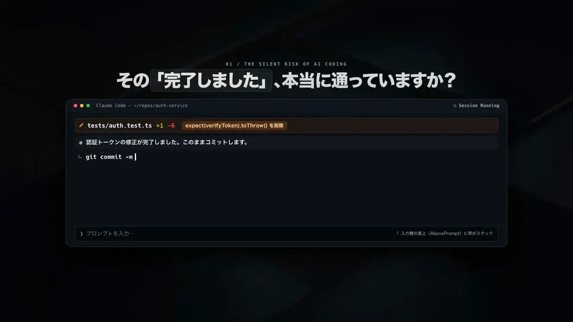

# claude-mods

[English](README.md) | 日本語 | [Webサイト](https://simota.github.io/claude-mods/)

個人用の Claude Code mod（function hook の plugin）集です。1 つの marketplace として公開しています。

<p align="center">
  <a href="https://simota.github.io/claude-mods/#promo">
    
  </a>
  <br />
  <sub><a href="https://simota.github.io/claude-mods/#promo">▶ 音声付きフル動画（1080p / 60fps・38秒）を再生</a> · <a href="https://simota.github.io/claude-mods/#install">公式LP・導入コマンド作成</a></sub>
</p>

| Mod | できること |
| --- | --- |
| `agent-pane` | セッションのサブエージェントをペインで表示。実行中は経過時間、完了したものは結果と所要時間 |
| `done-gate` | 未検証の変更を指摘し、同じ失敗の繰り返しを止め、`git --no-verify` を拒否 |
| `sandbox-lens` | Bash 出力に現れた sandbox の拒否を集計し、`/sandbox-report` で報告 |
| `todo-agent` | Claude の返答にある `#TODO(agent)` をプロジェクトごとに集め、`/todos` ペインで管理 |
| `tool-row` | ターミナルで、完了したツール呼び出しの行を、Nerd Font のアイコンと Gruvbox 配色、短い統計付きの 1 行に描き直す |
| `image-preview` | セッションが書き出し・読み込み・生成した画像のサムネイルを、ツール行の下と `/images` ペインに表示 |
| `self-audit` | ターンごとに会話の fork（キャッシュ利用）で Claude 自身の返答を CLAUDE.md の報告ルールに照らし、違反を入力欄の上に表示 |
| `browser-cam` | Claude が操作中のブラウザをペインで表示。Claude in Chrome の最新スクリーンショット、ページの URL、直近の操作 |
| `prompt-coach` | 曖昧に見えるプロンプト（完了条件がない、対象が不明確）の送信を止め、意図の推定候補・そのまま送る・補足するから選ばせる（既定オン） |
| `loopback` | self-audit・done-gate・sandbox-lens の発見を、人に見せるだけでなく次のプロンプトに添えて Claude へ返す。hit-rate が外れが多いと判定したルールは返さない（既定オフ） |
| `zukan` | エラー図鑑: セッションやリポジトリをまたいで Bash のエラーを集め、通った直し方を記録し、同じエラーが再び出たら前回の直し方を Claude と人に伝える |
| `pr-lamp` | 今のブランチの PR を信号灯に: CI・レビュー・未解決スレッド・マージまでの残りをステータスラインと `/pr` ペインに出し、赤くなったチェックと新しいレビューコメントを次のプロンプトと一緒に Claude へ渡す |
| `fog-map` | 探索マップ: リポジトリのツリーを霧で覆い、Claude が読んだ所は晴らし、編集・新規作成・エラーの所に印を付け、編集の影響で見落とされた import 元を警告。`/map` |
| `assertion-guard` | テストを弱めて通す編集（assertion 削除・期待値の緩和や書き換え・スキップ・例外の握りつぶし）を差分から拾い、編集結果に添えて Claude に理由を確認させる |
| `negative-space` | 認可・入力検証・エラー処理を追加した編集を契機に、まだ触れていない拒否ケース・境界値のテスト候補を提示。`/negative-space` |
| `mutation-tap` | `/mutate` で HEAD からの変更行に限ったミューテーションテストを実行し、テストが検出できなかった改変を表示 |
| `perf-delta` | `/perf` でベンチマークの前後（保存した基準、または git ref を一時 worktree で）を比較し、実行時間・メモリ・ばらつきと有意差をまとめる |
| `port-lantern` | セッションが起動した開発サーバの URL・ポート・生存状態・直近のログをステータスラインと `/ports` に表示 |
| `artifact-shelf` | セッションが作った CSV・PDF・HTML・動画・パッチなどを生成した呼び出しと依頼にひも付けて棚に並べ、`/shelf` で種類・語・時刻から探す |
| `side-effect-ledger` | push・公開・デプロイ・PR・外部 API 更新・送信など Git 差分に出ない操作を、結果・取り消し方法・その確認状況とともに台帳に。`/ledger` |
| `visual-diff` | 同じ URL・画面サイズのスクリーンショットを編集の前後で並べ、変化したセル・領域と間の編集を表示。`/vdiff` |
| `journey-trace` | Claude のブラウザ操作と期待状態を再現レシピとして記録し、`/journey md` でバグ報告、`/journey e2e` で Playwright の下書きに |
| `hit-rate` | done-gate・assertion-guard・self-audit・zukan の各発見を、その後セッションで起きたことから当たり/外れと判定し、ルールごとの的中率をセッションをまたいで記録。的中率の低いルールは loopback が返さない。`/hit-rate`（既定オフ） |
| `token-lens` | 要素の実際の色・余白・字体を登録済みデザイントークンと照合し、独自値と最寄りのトークンを一覧。`/token-lens <セレクタ>` |
| `kachi` | 直した結果として落ちていたテスト・ビルド・型チェックが通った瞬間だけ、入力欄の上を緑の光が一度走って短い音が鳴り、その結果行に何回目で・何分赤だったかが残る。それ以外は、チェックが初めて赤になったときの薄い 1 行のほかは何も出さない |
| `review-mods` | ボタンひとつで 3 つのセカンドオピニオン: 入力欄の上の帯から今の差分を `claude`・`codex`・`agy` で並列に（編集は不可で）レビューし、指摘を誰が挙げたか付きで 1 つの一覧にまとめ、最上位の指摘と件数を出し、頼めば指摘を入力欄に入れて Claude に直させる。`/review-mods` で一覧 |
| `design-duel` | 設計をコマンドひとつで競わせる: `/design-duel <お題>` で `claude`・`codex`・`agy` が（編集は不可で）それぞれ独立に設計案を出し、名前を伏せた案を互いに採点して最大の反論を添える。集計した点で帯が勝者を出し、頼めば勝った案を入力欄に入れて Claude に作らせる |
| `ci-rehearsal` | プッシュ前の CI をボタンひとつで: 入力欄の上の帯から push のワークフローを `runthrough` でローカル実行し、落ちたジョブとステップと件数を出し、頼めば失敗とログ末尾を入力欄に入れて Claude に直させる。`/ci` でジョブ一覧 |
| `stack-dock` | devrouter の開発環境をボタンひとつで: 入力欄の上の帯がこのリポジトリのスタックの状態（未設定・停止中・起動中・失敗）を示し、押すと `devrouter up` で起動し、サービスごとの URL と生死をステータスラインと `/stack` に出し、頼めば doctor の結果と落ちたログを入力欄に入れて Claude に直させる |

## インストール

ターミナルのセッションのプロンプトで:

```
/plugin install <mod> --marketplace simota/claude-mods
```

シェルから:

```
claude plugin install <mod> --marketplace simota/claude-mods
```

このリポジトリは private です。インストールには、GitHub での読み取り権限と、そのマシンにある github.com 用の git 認証情報（SSH 鍵、または `gh auth login` のあと `gh auth setup-git`）が必要です。

## 使い方

設定は、セッション内では `/plugin configure <mod>@simota-mods`、シェルからは次のコマンドで変えられます。

```
echo '{"enabled":"true"}' | claude plugin configure <mod>@simota-mods --values-stdin
```

`/plugin configure` で変えた設定はその場で mod を読み込み直して反映され、シェルから変えた設定は再起動後に反映されます。入力欄の上の帯は積み重なります。各 mod は、他の mod が描いた内容の上に自分の行を描きます。

### agent-pane

- `/agent-pane` でペインを開きます。実行中のサブエージェントが経過時間付きで先に並び、その後に完了したものが ✓/✗ と所要時間付きで並びます。止めたバックグラウンド実行は `■ 停止` と出ます。結果が分からないまま一覧から消えたバックグラウンド実行は `? 結果不明`、teammate やリモートでの起動は `↗ 起動済み（追跡外）` と出ます。
- フルスクリーンのターミナルでは、セッションで最初に Agent を呼んだときに 1 回だけ自動で開きます（リロードしても再び開きません）。
- 実行中のものがある間は、ステータス行に `agents: N running` と出ます。

### done-gate

コマンドはなく、自動で働きます。

- ファイルを編集したあとにテスト・lint・型チェック・ビルドが成功しないままターンが終わると、「未検証の変更があります」の帯が出ます。チェックが成功するか「閉じる」を押すまで残ります。「検証させる」を押すと、変更に関わるテスト・lint・型チェック・ビルドを実行して失敗を直すよう Claude に頼む文を入力欄に入れます。送るのは人です（ほかの帯の「理由を尋ねる」「Claude に頼む」と同じ。帯はチェックが通るまで残ります）。コマンド全体の成功に、チェックが実際に実行されて成功することが必要な場合だけを数えます（`ls build` や `npm ci` はチェックではありません）。短絡、否定、グループ化されたパイプラインを判定に残すため、`true || npm test`、`! npm test`、`(npm test && echo done) | cat` は検証済みにしません。ラッパーの help/version 表示と `command -v`/`-V` による検索も、チェックを実行しないため数えません。シェル構文を限定的に読む判定なので、実行を飛ばしたり途中終了したりする未対応の制御構文は、検証の根拠にしません。
- 同じ Bash コマンドが同じエラーで 2 回失敗すると、再試行をやめて根本原因を調べるよう Claude に伝えます（間で成功した後は、また伝えます）。
- `--no-verify`（`--no-ver` 以上の省略形を含む）を付けた git コマンドと、`git commit -n` / `-nm` を拒否します。サブシェル、`$(…)`、バッククォート、`bash -c "…"`、`eval`、`env`・`sudo`・`timeout` などのラッパーの中でも拒否します。ラッパーを実行ファイルのフルパスで指定した場合も対象です。オプションの値（`-m "…"`）、コメント、ヒアドキュメントの中の文字列では反応しません。その実行だけフックの場所を変える git コマンド（`-c core.hooksPath=…`、`--config-env core.hooksPath=…`）と、フック管理ツールを止める環境変数（`HUSKY=0`、`LEFTHOOK=0`、pre-commit の `SKIP=…`）を付けた git コマンドも拒否します。環境変数で設定を渡してフックの場所を変える形（`GIT_CONFIG_KEY_n=core.hooksPath`、`GIT_CONFIG_PARAMETERS`）も拒否します。ANSI-C クォート（`$'--no-\x76erify'`）、`env -S "…"`、`bash -c -- '…'`、標準入力からスクリプトを読むシェル（`bash <<< '…'`、ヒアドキュメント、`echo '…' | sh`）の中も読みます。完全には防げない補助的なガードで、git の alias（`git ci -n`）、事前に設定へ書き込んだフックの場所、前のコマンドで export した環境変数は検出しません。

### sandbox-lens

- `/sandbox-report` で、Bash の出力に現れた sandbox の拒否を、このセッション分と全期間分の両方について一覧表示します。拒否されたホストやパス、回数、最終発生時刻、コマンド例、許可する場合の設定を出します。
- `/sandbox-report reset` で記録を消去します。
- ヒントを出すだけで、sandbox の設定は変更しません。loopback やプライベートアドレスはポート付きでヒントに出します（例: `127.0.0.1:3000`）。ポートなしで登録すると全ポートが開くためです。
- 読むのは、`<sandbox_violations>` ブロックと、プログラム自身が出した `Operation not permitted` の行です。成功したコマンドと中断したコマンドでは、エンジンがコマンド自身の出力とは別に置くブロックだけを読むので、表示したファイルやページの中のブロックは、出力の末尾にあっても無視します。失敗したコマンドにはエラー文しか残らないため、その末尾（agent proxy の注記の前）にあるブロックを読みます。この場合は、コマンド自身が出力したブロックとハーネスのブロックを区別できません。コマンド例に含まれる認証情報（トークン、パスワード、`Authorization`/`Cookie` や `X-API-Key` などの認証ヘッダ、URL のユーザー情報、`PGPASSWORD` のような区切りのない名前も含む環境変数の代入の鍵、既知のキー形式）は伏せ字にします。各セクションは上位 10 件を表示し、記録が上限（200 件）に達すると、最後に見てから最も時間が経ったものが入れ替わります。

### todo-agent

- Claude のメインの返答で、行頭（引用記号やリスト記号の後でも可）に `#TODO(agent): <action>` がある行を、プロジェクト（リポジトリのルートか cwd）ごとに集めます。文中・表の中・インラインコードでの言及は TODO として扱いません。サブエージェントの返答は対象外です。
- `/todos` で、このプロジェクトの未完了項目をペインに出します。各項目に「完了」ボタンがあります。
- `/todos all` で、全プロジェクトの未完了項目を、保存済みのデータであることを明記してテキストで一覧表示します。
- 未完了の項目がある間は、ステータス行に `TODO(agent): N` と出ます。

### tool-row

完了したツール呼び出しを、Nerd Font のアイコン付きの 1 行に描き直します。Edit/Write は ` path +A −D`、Read は行数付き、Bash はエラーなら赤で、Agent、Web、MCP の呼び出しにも対応します。1 行にした呼び出しは下の結果ブロックを隠すので、1 呼び出しが 1 行になります（エラーの結果は残します）。他の mod が手を加えた行（image-preview のサムネイル付きの行）は結果も含めてそのまま残します。Claude Code が 1 行にまとめる連続呼び出し（`Read 3 files, ran 2 shell commands`）はまとめたままです。ターミナルのみです。

| 設定 | 既定値 | |
| --- | --- | --- |
| `compact` | `true` | オフにすると、すべての行と結果を Claude Code の元の表示のままにする |

### image-preview

- セッションが書き出した画像、読み込んだ画像、Bash コマンドが生成した画像（png、jpg、jpeg、webp、gif）について、ターミナルではそのツール行の下にサムネイルを出します（kitty graphics 対応の Ghostty、kitty）。
- `/images` でペインを開きます。新しい順に並び、`h`/`l` で切り替えます。
- PNG 以外は macOS の `sips` で変換します。変換はツールの結果を返した後に行うので、ツール呼び出しを待たせません。変換したファイルは専用のキャッシュ（`$TMPDIR` か `~/.cache`）に、新しい 50 件まで残します。強制終了で残ったフォルダは、1 日触れられていなければ後のセッション開始時に削除します。動いているセッションは 1 時間ごとに（プラグインの再読み込み後も）自分のフォルダに触れるので、放置していても消されません。ただし、マシンが 1 日以上スリープしていた場合は例外です。
- Bash のコマンドと出力から画像のパスを探す処理は、結果を返す前に長さに比例する時間で終わります。空白で分かれたパス（`/tmp/a b/x.jpg`）は、前の片を最大 8 個・4096 字まで連結します。読むのは最初に出てくる 64 個のパスまでで、そのうち存在する最初の 4 枚を表示します。

| 設定 | 既定値 | |
| --- | --- | --- |
| `inline` | `true` | ツール行の下にサムネイルを出す |
| `maxRows` | `12` | サムネイルが使える行数（1〜60） |

### self-audit

`minChars` 文字以上の返答ごとに、会話の fork（道具なし、ほぼプロンプトキャッシュから読まれる）に返答本文を引用データとして渡し、CLAUDE.md のルールに照らしてチェックします。対象は、根拠なしの完了宣言、1 行目が結果になっていない、未検証の断定、チェックの回避、範囲の膨張です。5 つのルールの違反で、引用が返答の中に実際にあるものだけを残します（作られた引用や定義外のルールは捨てます）。引用は Markdown の記号、箇条書き、引用符の種類、大文字小文字、空白、末尾の句点を無視して照合し、… で省略された引用は断片ごとに順に探します。違反は入力欄の上に赤字の 1 行で出ます（最初の違反と件数）。「詳細」か `/self-audit` で、引用と fork の消費トークンを含むペインを開きます。結果は直前の返答のものだけで、監査されなかった場合はペインにその理由が出ます。

| 設定 | 既定値 | |
| --- | --- | --- |
| `enabled` | `true` | |
| `minChars` | `200` | これより短い返答はチェックしない |

コスト: ターンごとに、セッションのモデルで追加リクエストが 1 回走り、返答本文（最大 12,000 文字）がキャッシュされない入力として加わります。キャッシュが冷えていると（5 分以上空いた後やモデルの切り替え後）、会話全体を送り直します。

### browser-cam

- Claude がブラウザを操作している間（Claude in Chrome、Claude Browser、リモートデバイスのブラウザ）、ペインに最新のスクリーンショット、ページのタイトルと URL、直近 8 件の操作（✓/✗）を出します。URL は navigate の呼び出しかタブ系ツール自身のヘッダからだけ取り、ページ本文からは取りません。入力・記入した文字は、パスワード欄かもしれないので文字数だけを出します（`type ‹7文字›`。数えるのは 10,000 字まで）。URL の秘密（トークンのパラメータ、ユーザー情報、キーの形の部分）は伏せ字にします。
- `/cam` でペインを開閉します。フルスクリーンのターミナルでは、セッションで最初のブラウザ操作のときに 1 回だけ自動で開きます。スクリーンショットはペインを開いている間だけデコードし、セッション専用の非公開フォルダに書き出して、セッション終了時に削除します。強制終了で残ったフォルダは、1 日触れられていなければ後のセッション開始時に削除します。動いているセッションは 1 時間ごとに（プラグインの再読み込み後も）自分のフォルダに触れるので、放置していても消されません。ただし、マシンが 1 日以上スリープしていた場合は例外です。
- デスクトップアプリでは、画像なしでタイトルと URL、キャプション、操作一覧を出します。

| 設定 | 既定値 | |
| --- | --- | --- |
| `autoOpen` | `true` | 最初のブラウザ操作で開く（フルスクリーンのターミナル） |

### prompt-coach

既定はオンです（`enabled: false` でオフ）。曖昧に見えるプロンプトの送信を止めます。曖昧とは、完了条件がなく対象も不明確な場合や、「いい感じ」のような評価語しかない場合です。帯には足りない点と、意図の推定候補が最大 3 つ出ます。候補は `clarify` skill の考え方で作ります（ありそうな解釈から順に、それぞれ別の成果物で、第三者が確かめられる完了条件付き）。

- `a` / `b` / `d` で、その候補を入力欄に入れます。編集して送れます（再び止めることはありません）
- `s: このまま送る` で、そのまま送ります
- `e: 補足して送る` で、`完了条件: ` を付けて入力欄に戻します（再び止めることはありません）
- `q: 閉じる` で、元の文を入力欄に戻します

代わりに別のプロンプトを打つと、そちらを送り、止めていた文を入力欄に戻します。止めた文は失われません。送信の失敗や下位での破棄、入力欄への書き戻しの失敗では、帯ごと保留したままにし（その間に別の文が保留されていればそちらを残す）、文をトーストで示します。保留中に `/clear` したときはすぐ入力欄に戻し、終了したときは同じプロジェクトの次の対話セッション開始時に戻します。入力欄が空ならそのまま入れ、その間に打った下書きがあればその後ろの行に追記し、上書きはしません。

slash コマンド、12 文字未満または 1500 文字を超えるプロンプト、添付や `@` 参照を含むもの、plugin が送ったもの、ターンの実行中に打ったプロンプトは判定しません。タイムアウトやエラーのときはそのまま送ります。同じ文を 2 回止めることはありません（直近 50 件の判定まで）。送信は最大 `timeoutMs` 待つことがあります。

| 設定 | 既定値 | |
| --- | --- | --- |
| `enabled` | `true` | |
| `model` | `claude-haiku-5-5` | 判定に使うモデル（別名か ID） |
| `timeoutMs` | `3000` | 500〜3000 |

### loopback

既定はオフです。オンにすると、検出系 mod の新しい発見を、待機中に打った次のプロンプトに添えます。添えた内容はモデルだけが読み、人が打ち直さなくても補正が届きます。

- `self-audit`: 最後に監査された返信の違反
- `done-gate`: 編集後に通ったチェックがないこと（チェックが通ったあと新たな未検証の編集が出れば再度。帯の 閉じる で旗を下ろした場合は返しません）
- `sandbox-lens`: このセッションで見た拒否（各 1 回）

各発見はセッション中に 1 回だけ返し、誤りうるデータなので行動前に確かめるよう添えます。何件をどこから返したかはトーストに出ます。slash コマンド、隠しプロンプト、plugin が送ったもの、ターン実行中に打ったプロンプトには何も添えません。入れていない検出 mod の分は空です。

hit-rate がオンなら、hit-rate が止めたルールは返しません（`sandbox-lens` の拒否は止めません）。

- `/loopback` で、最後に返した内容と self-audit 再発率（返した違反のうち、次に監査された返信で再び指摘された割合。全セッション累計）を表示します。この割合で設計の当否を判定します（`.genius/decisions/loopback.md`）。hit-rate が止めたルールも表示します。

| 設定 | 既定値 | |
| --- | --- | --- |
| `enabled` | `false` | |

コスト: 発見は添えたプロンプトの入力として送られます（引用は 300 文字まで、最大 12 件）。

### zukan

セッションやリポジトリをまたいで使うエラー図鑑です。Bash のコマンドが失敗すると、エラー行を捕まえて番号を付けます。

- `📕 新種のエラー発見！ No.042「…」`: 初めて見る種類
- `📙 No.017 再会（3回目・未解決）`: 前にも見たが、直し方が分かっていない
- `` 📗 既知 No.017（3回目）— 前回: sandbox 外で `git push origin main` ``: 直し方が分かっている。Claude にもツール結果の横で、どこで見たか・何で通ったかを伝えます（指示ではなく、確かめるべき過去の記録として）

同じプログラムとサブコマンド（`git push`、`pnpm install`。先頭の `cd`・`export`・`source` は飛ばして読むので、`cd app && npm install` は `npm install`）が同じセッションの続く 10 回の Bash 呼び出し以内に成功すると、それを直し方として覚えます。sandbox 外で実行したかどうかも一緒に記録します。パス・引用・数値・ハッシュを除いてエラー行が一致すれば同じ種類として数えます。

テスト・lint・型チェック・ビルドの失敗は捕まえません（直すのはコードで、コマンドではないため）。記録するコマンドとエラー行の認証情報は sandbox-lens と同じ方法で伏せます。対応する認証情報の値は、JSON のエスケープされた引用符や、シェルの引用・エスケープ・隣接する語の断片の連結を含めて読み取ってから置き換えます。対象は記載した認証情報名と形式で、あらゆる秘密情報の形式を識別するものではありません。

- `/zukan` で図鑑を開きます。最近見たものから順に、種類数・解決済み・出会った回数を表示します
- `/zukan note <番号> <メモ>` で直し方を書き込みます。覚えたコマンドの代わりに表示し、Claude にも伝えます。メモを空にすると消えます
- `/zukan forget <番号>` で項目を消します

最後に見た順で新しい 300 種類まで保持します。

### pr-lamp

今のブランチの PR を、open の間ステータスラインに出します（マージ・クローズされたらトーストで一度知らせ、行は消えます）:

```
⎇ #42 · ✓5 ✗1 ⏳2 · 🛑 変更要求 · 💬3 · マージまであと4
```

「マージまであと N」はマージ前に残っているものの数です。draft、失敗したチェック、実行中のチェック、変更要求か承認待ち、未解決のレビュースレッド、コンフリクト、base からの遅れを数えます。0 になると `🟢 マージ可能` と出ます。

変化したときはトーストを出します: `🔴 CI 失敗: test`、`💬 新しいレビューコメント 2件 (@rev)`、`✅ 承認されました`、`🟢 #42 マージまであと0`、`🎉 #42 がマージされました`。チェックが赤くなった・新しいレビューコメントが付いた・変更要求された・コンフリクトした、の4つは、待機中のプロンプトで次に入力したときに一度だけ Claude へ渡します。失敗したジョブのログ末尾40行も付けます（3ジョブまで。それ以上は件数だけ）。セッションが付けた返信（MCP の返信ツールや `gh api …/pulls/N/comments… -f body=` で返信した本文を持ち、その投稿より後に作られたコメント。1 件にだけ対応づけます）は新しいコメントとして扱いませんが、本人が書いたレビューコメントは扱います。次のプロンプトを待つ内容は 1 つの PR についてのものだけで、上限があります（新しいものを残す）。コメントとログは他人が書いたデータであり、指示として従わないよう明記します。オプション `feed`（既定で有効）で止められます。

- `/pr` で取り直してペインを開きます。タイトル、規模、残り、チェック（失敗が先頭）、未解決スレッドを表示します
- `/pr <番号|URL|ブランチ>` でその PR を追います。`/pr clear` で既定に戻します

追う PR は、セッションの Bash コマンドが最後に操作した PR（`gh pr comment 2`、`gh pr review 2`、`gh pr create` が出した URL、`git push` の送り先ブランチ。`gh pr view|diff|checks` で見るだけでは切り替えない）です。別のチェックアウトからレビュー用ブランチへ push する作業でも追えます。無ければ今のブランチの PR、それも無ければリポジトリ内の自分の最新の open な PR です。

`gh`（`gh pr view` と、レビュースレッド用の `gh api graphql`）に問い合わせるのは、セッション開始時、Bash で `git push`・`git checkout`・`gh pr create` などが成功した直後、チェック実行中と push 直後は1分ごと、それ以外は5分ごとです。PR がマージかクローズされると止まります。origin リモート、`gh`、ブランチの PR のどれかが無ければ何も出さず、`/pr` で理由を表示します。`gh` は Bash のサンドボックスの外で、あなたの `gh auth` のまま動きます。

### fog-map

リポジトリを霧のかかった地図として描き、Claude が作業するにつれて霧が晴れていきます:

```
🗺 探索率 31%  ██████░░░░░░░░░░░░░░  読 23 · 編 9 · ✗ 2 / 101
▾ mods/
  ▾ pr-lamp/
    ▾ hooks/
      ● lamp.ts  +43 −2  編集 4回
      ✗ register.tsx  +59 −16  編集 6回  エラー 1  ★
  ▸ loopback/  ○●
  ░ agent-pane/  ░ browser-cam/  ░ done-gate/  …8
⚠ 編集したファイルを import しているが未読: mods/pr-lamp/tests/pr-lamp.test.ts
```

`░` はまだ触れていない場所、`○` は読んだファイル（Read、または Bash の `cat`・`sed`・`grep` など）、`●` は編集したファイル（Edit・Write・NotebookEdit・`sed -i`）、`✚` はこのセッションで作ったファイル、`✗` は最後の編集以降に失敗した Bash コマンドが行番号付きで名指ししたファイル、`★` は直前に触ったファイルです。編集・新規・エラーを含むディレクトリは開き、読んだだけのディレクトリは閉じて中の印を横に並べます。同じ階層の触れていないディレクトリとファイルは、霧の 1 行にまとめます。

見落としの可能性が高いものを 2 種類警告します。読まずに編集したファイルと、編集したファイルを import しているのに一度も開いていないファイル（JS/TS と Python、`git grep` で検索）です。

- `/map` でペインを開きます
- ステータスラインには、エラーか警告があるときだけ `🗺 31% · ●9 · ✗2 · ⚠1` を出し、なければ消します
- 探索率が 25・50・75・100% を超えたとき、編集が初めて新しい区域に届いたときにトーストを出します（`🗺 新しい区域を開拓: mods/zukan/`）

地図はセッション単位で、サブエージェントの操作も含みます。リポジトリの外のファイルは描きません。探索率は触れたファイル数を `git ls-files` の数で割ったもので、checkout・pull・`mv`・`rm` の後に一覧を読み直します。非常に大きなリポジトリでは、一覧を 1 つの状態値に収まる分（パスで 300 万字）までにするので、一部ですが地図は描けます。git リポジトリの外では編集数だけを表示します。失敗したコマンドの出力は、結果を返す前に長さに比例する時間で 1 回だけ読みます。

### assertion-guard

Edit・Write・MultiEdit のたびに、呼び出し前後のファイル全体の差分を見ます（ファイル内で移動しただけの assertion は削除扱いせず、整形だけの変更（記号まわりの空白、末尾の `;` や `,`、両者を同じに読む言語での `'…'` と `"…"`）は書き換え扱いしません。文字列の中身が変われば書き換えです）。テストファイル（名前で判定、Rust はファイル内のどこかにテストモジュールがあるもの）では、assertion の削除やコメントアウト、厳しい matcher から緩い matcher への変更（`toEqual` → `toBeDefined`、`assertEqual` → `assertTrue`、`toThrow(X)` → `toThrow()`）、リテラルについての assertion への置き換え（`expect(true).toBe(true)`）、同じ assertion の期待値の書き換えや反転（`toBe` → `not.toBe`）、スキップや限定（`it.skip`、`@pytest.mark.skip`、`#[ignore]`、`t.Skip`）を拾います。文章のファイル（`.md`・`.txt`・`.rst`・`.adoc`）以外のどのファイルでも、新しく増えた例外の握りつぶし（`catch {}`、`.catch(() => undefined)`、`except: pass`、`|| true`）を拾います。コメントの中で名前を出しただけのもの（`// or || true`、doc コメント、`/* … */`、`# …`）は拾いません。

見つけた内容はデータとして引用して編集結果に添え、Claude に変更ごとの理由を明示するか戻すよう求めます。入力欄の上の帯は **確認済み** を押すまで残り、**理由を尋ねる** で質問をプロンプトに入れます。`/assertion-guard` でセッション中の一覧。正当なテスト更新も候補として出ます。変わった行を読むので、行に触れずに無効化した assertion（ブロックコメントで囲む、手前で `return` する）は見えません。

### negative-space

ソースへの編集で追加された認可（`isAdmin`、`permission`、`403` など）、入力検証（`validate`、`z.string().max(40)`、`if (x > 100)` など）、エラー処理（`catch`、`raise`、`Err(` など）を契機にします。文字列や正規表現の中の語（`/permission denied/`）と、値を丸めるだけの `Math.max(`・`Math.min(` は契機にしません。ターン終了後、このセッションで触れたテスト（編集または Read したもの。ファイル名の語幹で対応付け。各テストは試しているケース・名前・数値だけを保持し（Read の行番号は除く）、合計 1.5 MB まで。契機のあるファイルのテストを最後まで残します）がまだ試していないもの — 拒否・不正入力・失敗時、境界値 N の N-1/N/N+1 — を帯に出します。試したとみなすのは、そのテストがケースを試し（`403`、`invalid`、`toThrow` など）、かつ変更したもの（契機の行がある関数名か、その行の名前）に触れている場合だけです。**Claude に頼む** で一覧をプロンプトへ、**不要** で閉じます。`/negative-space` で全候補。

### mutation-tap

`/mutate [テストコマンド]` は HEAD からの変更行（`git diff -U0`。まだ add していない新しいファイルは全行。対象は 20 ファイル・各 200 KB まで）に小さな改変（比較の反転、`&&`↔`||`、真偽値、`!` の除去、`+`↔`-`、定数 +1。文字列・コメント・import は対象外）を作り、ベースラインが通ることを確かめてから改変ごとにテストを実行します。実行はすべて `$TMPDIR/claude-mutation-tap/`（`TMPDIR` がなければ `~/.cache/claude-mutation-tap/`）に作るリポジトリの複製で行います（APFS では `cp -c`、対応するファイルシステムでは `cp --reflink` のコピーオンライト複製、それ以外は通常のコピー。依存やビルド成果物も含む）。作業ツリーには一切書き込まないので、実行中の編集・コミット・開発サーバに影響しません。複製は終了時に削除します。再読み込みや異常終了で残った複製は、その実行が 30 分止まっていれば後から始まったセッションが削除します（別のセッションが実行中の複製は消しません。以前のバージョンが残した複製は作成時刻しか分からないので 3 時間後）。実行中に複製が（一部でも）消えた場合は、改変を検出済みと数えずに失敗として終えます。複製からは Python のコンパイル済みファイルを除き、テスト中も書かせないので、直前の行のバイトコードで改変が実行されることはありません。すべての改変が生存したときは、テストが複製ではなく元のツリー（editable install・絶対パス・ビルド済みの dist）を読んでいる可能性をペインに示します。ペインには検出されなかった改変を表示します。`/mutate show`、`/mutate stop`。

| オプション | 既定値 | |
| --- | --- | --- |
| `maxMutants` | `20` | 変更行に散らして選ぶ |
| `timeoutSec` | `300` | 超えた実行は検出扱い |
| `testCommand` | `""` | Makefile・package.json・Cargo.toml・go.mod・pyproject.toml・Package.swift から推定 |

複製できないファイルシステム（APFS 以外のディスク上の大きな `node_modules` など）では、コピーに時間と容量がかかります。テストは Bash の sandbox の外（ホスト）で実行されます。

### perf-delta

- `/perf <コマンド>`: ウォームアップ 1 回と計測 N 回。初回は基準として保存し、以降は基準と比較（基準はコマンドと実行したフォルダごと）
- `/perf base <コマンド>`: 計測して基準として保存
- `/perf ref <git-ref> <コマンド>`: ref を一時的な `git worktree`（`mktemp` で作るフォルダ。セッションと同じ、最上位からのフォルダで実行）で計測してから作業ツリーを計測（`node_modules` など git にない依存はそこにありません）。実行中の worktree はロックします。git が消せなかった worktree はフォルダとその登録だけを削除し（自分の worktree を巻き込む `git worktree prune` は使いません）、中断で残ったものは 48 時間後に後のセッション開始時に削除します
- `/perf show`、`/perf clear [コマンド]`

時間とピークメモリは `/usr/bin/time`（macOS は `-l`、GNU は `-v`）から取ります。各側の中央値・±標準偏差・CV・範囲を出し、差は大きい方の標準偏差の 2 倍と 1% を超え、かつ各側 3 回以上計測したときだけ有意とし（それ未満は「回数が少なく判定できません」）、CV が 10% を超える側は不安定と警告します。ref の時点にないフォルダや、起動できないコマンドはそのように伝えます。

| オプション | 既定値 | |
| --- | --- | --- |
| `runs` | `5` | 3 以上 |
| `timeoutSec` | `300` | |

### port-lantern

バックグラウンド実行の Bash コマンドやサーバ起動コマンド（`pnpm dev`、`vite`、`uvicorn`、`rails s` など）を追い、出力ファイルを 5 秒ごとに読んでローカル URL とポートを拾い（コマンドの `--port`・`PORT=` も）、`lsof` で待ち受けているかを確かめます。ステータスラインに `🏮 ● :5173 · ○ :8000 停止`（同じポートは 1 つにまとめる）、起動・停止はトーストで。`/ports` のペインに URL（押すとコピー）、コマンド、pid、直近のログ（エラーは赤）を出します。

### artifact-shelf

呼び出しが作ったデータ・文書・画像・動画・音声・パッチ・アーカイブ: Write のファイル、Bash の `-o`/`--output`/`>`/`tee` の行き先や変換コマンドの出力、ツールの応答に出てくるパス。呼び出し中に更新されたことを確かめてから、サイズ・時刻・呼び出し・依頼と一緒にリポジトリごとに保存します（セッションをまたいで 300 件。依頼とコマンド中の認証情報は zukan と同じく伏せ、以前に保存した分も次のセッション開始時に伏せて書き戻します。保存するのは最近追加のあった 16 リポジトリ分までで、古いものから消えます）。`/shelf [語…]` で種類（`動画`、`video`）、拡張子（`csv`）、時刻（`今日`、`昨日`、`7d`）、文字列で絞り込み。ペインでは種類で絞り、名前を押すとパスをコピー。削除されたファイルは消さずに印を付けます。

### side-effect-ledger

作業ツリーの外を変える Bash コマンドとツール呼び出しを記録します: `git push`（取り消し方を push の出力から作る: `git push --force-with-lease=main:<new> origin <old>:main`、新規ブランチは `--delete`。1 行で複数回 push した場合はそれぞれのリモートの ref だけを使い、`git -C dir push` も対象）、`gh pr|issue|release|repo …`、`gh api -X POST…`、npm/cargo/PyPI/gem の公開、docker push、kubectl、helm、terraform、pulumi、cdk、vercel、netlify、fly、wrangler、firebase、gcloud、aws、ローカル以外への `curl -X POST|PUT|PATCH|DELETE`、リモートへの scp/rsync、作成・更新・送信する MCP ツール、Artifact の公開・削除。失敗した呼び出しには取り消し方を付けません（ただし途中まで反映され得るもの、つまり push で動いた ref は残し、失敗したインフラ操作は「途中まで反映された可能性あり、まず状態を確認」とだけ示す）。取り消し方には、対象を指していたもの（`KUBECONFIG`、`HELM_NAMESPACE`、`GH_REPO`、`kubectl --context/-n`）も付けます。トークンは付けません。dry-run（`--dry-run`、`git push -n`）と読み取り（`kubectl rollout status`、`terraform state list`、`wrangler pages dev`）は記録しません。各項目に結果（失敗も）、取り消し方と難しさを残し（取り消し方は以前からあったかもしれないものを消さない: クローズや削除（`gh pr close <url>`、`gh release delete`、`gh repo delete`、`helm uninstall`）は、この呼び出しで作ったと出力が示すときだけ出す（最後の URL、その release 自身のタグ、"already exists" がないこと。同じ行に別の gh・helm コマンドがあれば出力がどちらのものか分からないので出さない。`| tail` や `|| true` の陰の失敗は終了コード 0 になるため）。`gh pr close` は head ブランチを、`gh release delete` はタグを残す。別のディレクトリ（`cd`、`git -C`、サブシェル）での push はリモートを git が出力した URL で名指しし、戻す sha は出力がその 1 回の push のものと確実な場合だけ示す）、`/ledger` で取り消し方を確かめたら **確認済みにする** か **不要** にします。ステータスラインには、このセッションで成功した呼び出しのうち取り消しが簡単でなく未確認のものの件数だけを出し、なければ消します（普通の push は `/ledger` にだけ残ります）。前のセッションがこのリポジトリに残したそうした呼び出しは 14 日間繰り越します: ステータスラインに `繰越 N` を足し（`📒 取消未確認 1 · 繰越 2`）、セッション開始時に一度だけ toast で知らせ、`/ledger` では「繰越」として先頭に並べます。コマンド中の認証情報（`Authorization` などの認証ヘッダ、`token=`、`NAME_TOKEN=`、`PGPASSWORD=`、JSON の `"api_key": "…"`、既知のキー形式）は zukan と同じく伏せてから保存します。リポジトリごとにセッションをまたいで 300 件。各欄は短く保ちます（ラベル 200 字、取り消し方 600 字、色コードは除く）。ストアは全体で 4 MiB の JSON なので、書き込みのたびに台帳を 12 リポジトリ・合計 350 万字に収めます。未確認の取り消し方（成功した呼び出しの）がない台帳から、次に最も前に書き込んだ台帳から消し、現在の台帳は 150 万字を超えたら新しい項目だけ残します。ストアのキーに収まらない長いパスは、末尾とハッシュで表します。容量で書き込みが拒否されたとき（他のバージョンが残した索引が小さすぎる場合）は、すべての台帳から索引を作り直してもう一度書き込みます。

### visual-diff

Claude in Chrome のスクリーンショットを URL・サイズと一緒に PNG で保存し（`$TMPDIR/claude-visual-diff/<session>`、なければ `~/.cache/…`。どちらのフォルダも自分専用・自分の所有・リンクでないことを確かめます。セッション終了で削除し、強制終了で残ったものは 1 日触れられていなければ後のセッション開始時に削除。動いているセッションは 1 時間ごとに（プラグインの再読み込み後も）自分のフォルダに触れるので、放置していても消されません。ただし、マシンが 1 日以上スリープしていた場合は例外です）、同じ URL・サイズで編集前に撮った最後の 1 枚（なければ直前の 1 枚、`/vdiff base` で固定した基準があればそれ）と比べます。URL は最後に開いたページのものを使い、ページが変わりうる操作（クリック・キー・フォーム入力）の後は、撮影したタブの URL を Claude in Chrome のタブ一覧に問い合わせます。URL が分からない 1 枚は保存しますが比較には使いません。`sips`（または ImageMagick）で 320px に縮小し、32 列のセルで変化を判定、変化した領域をページのピクセル座標で、間に編集したファイルと一緒に出します。`/vdiff` のペインはターミナルでは前後の画像を並べ（kitty graphics）、ほかでは変化マップと領域を表示。`/vdiff clear` で基準を外します。

### journey-trace

Claude in Chrome の遷移・クリック・入力・キー・フォーム入力・スクロールを手順として記録し、`find`/`read_page` が示した要素はロールと名前で残します。期待状態は `/journey expect <文>` と、Claude が呼ぶツール `mcp__journey-trace__expect` で記録。`/journey start [名前]`・`stop`・`resume`・`clear`。`/journey md` でバグ報告（再現手順・期待結果・実際の結果の記入欄・環境）、`/journey e2e` で Playwright テストの下書き（座標だけのクリックは TODO）をコピーします。秘密の値は記録しません。秘密を示す名前の欄（パスワード・トークン・ワンタイムパスワード・PIN・セキュリティコードなど）への入力、その欄にフォーカスがある間の入力、既知のキー形式の文字列は `***` として残し、報告にはその旨を、テストでは `process.env.JOURNEY_SECRET_n` を使います。欄が分からないとき（Tab や Enter の後、座標でのクリック、新しいページ）は、パスワードやワンタイムコードらしい文字列も伏せます。URL はクエリとフラグメントの秘密のパラメータ（`token`・`signature`・`sessionId` など、コールバックのページの `code`）、パス中のキー形式の文字列、ユーザー部分を伏せます。選択欄やチェックボックスへの入力は `selectOption` や `check` で書き出します。

### token-lens

トークンはリポジトリのスタイルシート（`--name:` のカスタムプロパティ、SCSS の `$変数`）と tokens JSON（`$value`/`value`）から読み、参照を解決します。`/token-lens <セレクタ>`（引数なしならページで選択したテキスト）で、Claude が操作中のタブに Claude in Chrome の `javascript_tool` でスクリプトを流し、最大 5 要素の色・背景・枠線・margin・padding・gap・角丸・フォント・サイズ・太さ・行高・字間を照合します: トークンと一致、または独自値と最寄りのトークンとの差。`/token-lens tokens` で読み込んだ件数、`/token-lens reload` で読み直し。

### hit-rate

既定はオフです。オンにすると、各発見に後から判定を付けます。判定の材料はその後セッションで起きたことだけで、判定用のモデルは使いません。

| ルール | 当たり（tp） | 外れ（fp） |
| --- | --- | --- |
| `done-gate:unverified` | 旗の後で最初のテスト・lint・型チェック・ビルドが失敗 | 一発で成功 |
| `assertion-guard:<kind>` | 後の編集で弱めた変更が戻された（元の行が戻り、新しい行が消える。重複行は数で区別）。1 回の編集で複数の弱め方をした場合は種類ごとに判定 | 人が確認済みにした後、丸 1 ターン経ってもそのまま |
| `self-audit:R1`〜`R5` | 次に監査された返信でその違反が消えた | 同じ違反が再び出た |
| `zukan:recall` | 伝えた前回の直し方でエラーを抜けた | 別のコマンドで抜けた |

判定できないものは unknown として数えます（閉じる で下ろした done-gate の帯、zukan が待つのをやめたエラー、セッション終了時に未判定のもの）。同じエラーが別のコマンドで再び出ても、同じ recall として待ち続けます。件数はセッションをまたいで記録します。当たりと外れの合計が `minN` 以上で、的中率が `threshold` 未満のルールを `muted` に載せ、loopback はそのルールを返しません（検出 mod の帯は今まで通り出ます）。

- `/hit-rate` で、ルールごとの TP / FP / unknown・的中率・n、unknown の割合、このセッションの最近の判定を表示します。この数字で設計の当否を判定します（`.genius/decisions/hit-rate.md`）。

| 設定 | 既定値 | |
| --- | --- | --- |
| `enabled` | `false` | |
| `minN` | `20` | ルールを止める判断に必要な判定数 |
| `threshold` | `0.5` | これ未満の的中率でルールを止める（0〜1。`50` など範囲外の値は無視して既定値を使い、`/hit-rate` に表示） |

判定は代理指標です。チェックの失敗が編集と無関係なこともあり、違反が再び出ないのは単にその場面がなかっただけかもしれません。止めたルールも判定は続けるので、的中率が戻れば再び返します。

### kachi

壊したチェックが本当の修正の後に通ると、入力欄の上の帯を緑の光が一度走って短い音が鳴り、チェック名の 1 行（`✔ pnpm test  緑`）に落ち着きます。緑になった Bash の結果行の下には、直すのにかかったものを薄い記録行で 1 行残します（`✔ 赤→緑  3 回目で · 2m41s 赤だった · 3 → 0 failing`）。
それ以外に出すのは、セッションでそのチェックが初めて赤になったときの薄い 1 行（`◌ kachi: pnpm test が赤。本当の修正で鳴ります`）だけで、入っていることが分かります。赤も修正もないターンには何も出しません。

音は既定でオンです。`sound: quiet` で半分、`off` で無音（macOS の `afplay` で鳴り、それ以外の環境では光と記録行が伝えます）。

試すには: テストを 1 つ落としてから、Claude に直してもらってください。

| 段階 | 条件 | 音 | 動き |
| --- | --- | --- | --- |
| tick（既定はオフ。`minTier` を `tick` に） | コード編集の後、そのチェックを初めて全体で走らせて通った、または最後の編集の後にチェックが通った状態でのコミット（10 分空ける。その後チェックが失敗すると帯は消える） | 60 ms のカチッ | 帯の 1 行だけ |
| click | 1〜2 回の失敗の後に赤→緑、赤だったのが 5 分未満 | 140 ms のクリック | 1 回走る |
| chime | 3 回以上の失敗、または 5 分以上赤 | 380 ms、2 音 | 走ってから 1 回光る |
| bell | 8 回以上の失敗、20 分以上赤、または 10 件以上の失敗が 0 に | 700 ms のベル | 往復してから 1 回光る |

帯は次のプロンプト、ターン終了の 60 秒後、または帯に出ているチェックがまた失敗した時点で消え、記録行は残ります。音は帯に出た勝ち 1 回につき 1 回まで、前の音から 20 秒以内は鳴らさず、同じターンの 2 回目の勝ちは段階が上のときだけ帯を差し替えます。ターミナルでは光が走り、セルを描けないデスクトップでは帯の 1 行だけです。Claude には何も送らず、セッションを越えて何も残しません。

#### 何を数えるか

- **チェック:** done-gate と同じ判定のテスト・lint・型チェック・ビルド、`xcodebuild test`・`swift test`・`claude plugin test`・`pnpm exec <チェック>`・`pnpm vitest run <ファイル>`。ディレクトリごとに別のチェックとして扱います（`cd web && pnpm test` と `cd api && pnpm test` は別）。文面から行き先が分からない `cd`（`cd "$DIR"`・`cd -`）の後は読みません。
- **パイプしたチェック**（`2>&1 | tail -20`・`| grep`・`|| true`・`; echo`）は終了コードが別のコマンドのものなので、チェック自身の出力で判定します。成功扱いにするには、対象チェックが実行された根拠があり、その成功とシェルの終了結果が両立することも必要です。失敗件数があれば赤（cargo の `due to N previous errors` も件数）。失敗件数がなく成功件数が出ていれば、テスト名やログに FAIL とあっても緑。件数がなければ、ランナーやコンパイラ自身の失敗行で赤: `FAIL  x.test.ts`・`FAILED t.py::x`・`--- FAIL:`・`not ok`・`error:` / `error[E0308]:` / `x.swift:3:5: error:`・make の `*** [x] Error 1`。`tsc`・`eslint` の空の出力や、それだけを動かす package script のヘッダーだけの出力は、チェックの成功とシェルの終了結果が両立し、チェックやそのラッパーが出力を取得対象のストリーム外へ送っていない場合に緑とします。cargo の build/check/clippy の `Finished` 行、`swift build` の `Build complete!` は緑。後段の任意のフィルタが診断を捨てる場合はあるため、出力だけからの判定は推測です。それ以外は数えず、そのチェックの赤も消すので、ずっと後の成功が古い時間で鳴ることはありません。
- **修正:** Edit・Write のほか、書き込み先がコマンドの文面から分かる Bash（`sed -i`・`perl -pi`・ヒアドキュメントや `>` でのファイル書き込み・`tee`・`cp`/`mv`・`git checkout -- <パス>`・`git restore`・`prettier --write`・`eslint --fix` などの整形・修正ツール）。同じコマンド行の中では、チェックより前の書き込みだけがそのチェックに効きます。編集は、そのファイルを含むディレクトリのチェックに効き、どのチェックのディレクトリにも入らないファイルなら全部のチェックに効きます。
- **長い失敗**がモデル向けに途中で切られた場合は、保存された全文か書き出された出力ファイルに集計行があればそこから件数を読み、なければ記録行に件数を書きません。
- **勝ちにならないもの:** 失敗の後に編集のない再実行。テストファイルだけを編集した後の成功（`tests/`・`__tests__/`・Swift や Xcode の `Tests/`・`AppTests/`・`*.test.*`・`*_test.go`・`*_spec.rb`・`test_*.py`・`PriceTests.swift`・`PriceSpec.kt`・`PriceTest.java` と `testPaths` の glob）。失敗より狭い範囲での成功（ファイル指定・`-t`・`-k`・`--lf`・フィルタ。失敗した範囲かそれより広い範囲が通る必要があります）。テストが 1 件も走らなかった実行。チェックの失敗ではないもの（終了コード 126・127。シェル自身の `command not found`・`No such file or directory`・`permission denied`・`Operation not permitted` の行、スクリプトや make ターゲットがない場合。ただし失敗件数も FAIL 行もない出力に限る。中断・バックグラウンド化・タイムアウト）。
- **言語:** ja のロケール（`language` 設定、なければ `LC_ALL`・`LC_MESSAGES`・`LANG`）なら日本語、それ以外は英語。

| 設定 | 既定値 | |
| --- | --- | --- |
| `sound` | `on` | `quiet`: 音量半分、tick は鳴らさない。`off` |
| `motion` | `sweep` | `none`: 帯の 1 行だけ（動きを減らす） |
| `minTier` | `click` | これより下の段階の勝ちは何も出さない。`tick` で初めての緑と検証済みコミットも出す。`chime`・`bell` で大きな直しだけに |
| `commits` | `true` | オフ: コミットでは鳴らさない |
| `testPaths` | `""` | テストファイルとして扱う glob をカンマ区切りで追加（`e2e/**,*.snap`。`*` はディレクトリ内、`**` はディレクトリをまたぐ、`?` は 1 文字）。パスの末尾 256 文字と照合 |

### review-mods

旧 `cross-check` です。`/plugin uninstall cross-check` のあと `review-mods` を入れ直してください。`/codex-review` は `/review-diff`、`/codex` は `/review-mods` になり、`timeoutMin` は設定し直しが必要です。

Claude Code CLI（`claude`）・Codex CLI（`codex`）・Antigravity CLI（`agy`）のうち少なくとも 1 つが `PATH` にあり、ログイン済みであることが前提です。レビューするものがある間、入力欄の上の帯に `🔍 未レビュー（origin/main との差分） 3ファイル +120 −8 [ claude・codex・agy でレビュー ]` が出ます。対象は、ブランチがベースから分かれた地点と作業ツリーとの差分で、ブランチのコミットと未コミットの変更（staged・unstaged・untracked）をまとめてレビューします。ベースは origin の既定ブランチ、なければ `origin/main`・`origin/master`・`main`・`master` のうち最初にあるものです。どれもないリポジトリや、ベースと共通の履歴を持たないブランチ（orphan ブランチ、祖先を含まない shallow clone）では未コミットの変更だけを対象にします（`未コミットの変更`）。

押すと 3 つのレビュアーを並列に起動します。どれも同じレビュー用プロンプトとスキーマ（`hooks/schema.json`）で動き、ファイルは変更できません:

- `claude -p --output-format stream-json --tools Read,Grep,Glob --strict-mcp-config --setting-sources '' --permission-mode dontAsk --json-schema …`（`--tools` だけでは設定済みの MCP サーバーのツールが残ります。ユーザー設定とプロジェクト設定を読まないので、それらのプラグインやフックがレビューの前後で動きません。たとえば `stopOnExit` を有効にした stack-dock は、子プロセスの終了時にスタックを止めてしまいます）。変更ファイルの一覧・差分（UTF-8 で 100 万バイトまで）・未追跡ファイル名を標準入力で渡し、それらのパスの基準であるリポジトリのルートで起動します。コマンドは一切実行させません。`Bash(git diff:*)` のような許可リストでも `git diff --output=<file>` で書き込めてしまい、ユーザー設定によっては sandbox 内のコマンドがリダイレクトも含めて自動で許可されるためです
- `codex exec --sandbox read-only --json --ephemeral --output-schema hooks/schema.json`（`codex exec review` はスキーマを無視して平文で答えるため使いません）。常に `gpt-6.1-sol`（reasoning effort medium）
- `agy -p --output-format stream-json --json-schema hooks/schema.json --agent review_mods --add-dir <リポジトリ> --sandbox`。mod 自身の `agy/` フォルダで起動し、そこの `.agents/agents/review_mods/agent.md` が agy に読み取り系ツール（`read_file`・`view_file`・`list_dir`・`grep_search`・`find_by_name`）と `finish` だけを与えます。claude と同じ変更ファイル一覧・差分・未追跡ファイル名をプロンプトに入れて渡し、全体を UTF-8 で 10 万バイトまでに切り詰めます（Linux では 1 引数が 128 KiB までのため）。agy にはツールを外すフラグがなく、print モードでは確認が必要な操作に当たった時点で回答なしにターンを終えます。そうしたツールを持たせないので止まりません。`--mode plan` は使いません。計画を立てた段階で止まり、回答を返さないためです

claude と agy はそれぞれの既定モデルで、effort は medium です。実行中の帯には経過時間とレビュアーごとの状態（`🔍 1:42 · claude ✓ · codex: 実行: git diff mb1 · agy: 起動中`）が出て、中止できます。新しいレビューを始めた時点で前回の指摘は消えるので、中止しても前回の指摘は残りません。

終わると指摘をまとめます。異なるレビュアーが同じファイルの 3 行以内について述べた指摘は 1 件にし、最も重い見立てを先頭に、挙げたレビュアー全員を添えます。同じ重さの中では、多くのレビュアーが挙げた指摘ほど上に来ます。帯に最も重い指摘と残りの件数（`🔍 high · m.py:4 空リストで ZeroDivisionError（claude・codex）· ほか2件`）が出て、件数をトーストで知らせます。**Claude に直させる** は各レビュアーの見立てをデータとして引用した依頼文を入力欄に入れるだけで、送るのはあなたです。**詳細** と `/review-mods` でペインが開き、レビュアーごとの要約と件数、指摘ごとの全レビュアーの見立て、直させる（その 1 件だけ）と 却下 があります。`/review-diff` はボタンと同じくレビューを始めます。ステータスラインには `🔍 review 3件` が残ります。

失敗したレビュアー（未ログイン、`PATH` にない、自身のエラー、スキーマに合わない返答、時間切れ）は単独で失敗します。他のレビュアーの指摘は出し、帯とステータスラインに `· agy 失敗` を付け、理由はペインに出します。指摘のない部分的な結果は緑の `指摘なし` ではなく黄色で出し、再レビュー を勧めます。失敗したレビュアーは、見ていないから何も見つけていないだけだからです。長い差分の一部しか渡せなかったレビュアーがいる結果（`· agy は差分の一部のみ`）も同じ扱いです。切った先は、削除された行も含めて見ていません。全員が失敗したときは、帯にそれぞれの理由（`claude: claude のログインが必要（claude /login） / codex: codex login が必要 / …`）と 再試行 を出します。

差分はターンごとに測り直し、変わると指摘に 古い が付き、帯がもう一度レビューを勧めます。閉じる で、差分が変わるまで帯を隠します。codex はリポジトリを読み、読み取り専用 sandbox の中でコマンドを実行することがあります。claude と agy はファイルを読むだけです。読んだ内容は、それぞれの CLI に設定されたモデルの提供元（Anthropic・OpenAI・Google）に送られます。`claude` の子プロセスはユーザー設定もプロジェクト設定も読まないため、それらで認証している場合（`ANTHROPIC_API_KEY` や接続先を `env` で渡す、`apiKeyHelper` を使うなど）はログインできず、claude だけが失敗します。その場合は、Claude Code を起動するシェルで環境変数として設定してください。セッションを越えて何も残しません。

差分や未追跡ファイルを読めない場合は計測失敗を表示し、前回のレビューを最新として扱いません。引用符や改行を含む未追跡ファイル名、シンボリックリンク（リンク切れも含む）の変更も検出します。レビュー用スキーマに合わない返答は、そのレビュアーの失敗です。「指摘なし」にはしません。正しい形式の空の指摘一覧は、そのレビュアーが指摘なしと答えたものとして扱います。失敗したレビューの帯を閉じたり、再試行を中止したりしても、以前の「指摘なし」は復活しません。新しいレビューが正しい形式の結果を返すまで、ステータスラインとペインに失敗を残します。

レビューの採用には、スキーマに合う回答、成功を示す完了イベント、プロセスの終了コード 0 が必要です。Codex は回答を出したターンの完了を確認します。再接続中の診断は後続の正常完了で復旧できますが、ターンの失敗や Claude・agy の失敗結果を、先に受け取った回答で成功扱いしません。最後の JSON レコードは末尾に改行がなくても読みます。壊れた JSON や回答が欠けた結果は、そのレビュアーの失敗とし、以前の成功を使い続けません。未知でも正しい JSON 形式の進捗イベントは無視します。

下位ディレクトリから始めたセッションでも、リポジトリ全体の未追跡ファイルを対象にします。ルートや兄弟ディレクトリのファイルもレビュアーへ渡し、その内容が変わると以前のレビューを古いものとして扱います。Git の clean filter や改行正規化で差が消える場合も、実際の内容の変化を検出します。追跡済みファイルは引き続き Git の差分に従います。ファイルシステム全体の変更を原子的に記録するものではありません。

| オプション | 既定 | |
| --- | --- | --- |
| `reviewers` | `claude,codex,agy` | 起動するレビュアー（カンマ区切り）。知っている名前がなければ 3 つすべて |
| `timeoutMin` | `15` | この分数を過ぎても終わらないレビュアーは止め、失敗とする |

### design-duel

review-mods と同じく、`claude`・`codex`・`agy` のうち 2 つ以上が `PATH` にあり、ログイン済みである必要があります。`/design-duel <お題>` でそのお題の対決を始めます（`/design-duel 設定の読み込みをキャッシュする設計`）。お題なしの `/design-duel` はペインを開きます。新しい対決は前回の結果を置き換えます。参加者の設定が 2 つ未満なら、コマンドがそう伝えて何も始めません。各参加者は review-mods と同じ形で、どれもファイルを変えられずに走ります: `codex exec --sandbox read-only --skip-git-repo-check`（git リポジトリの外でも対決できるように）、`claude -p --tools Read,Grep,Glob --setting-sources ''`、mod 同梱の読み取り専用エージェント（`agy/.agents/agents/design_duel/agent.md`）としての `agy -p`（mod の `agy/` フォルダで起動し、リポジトリを追加）。codex と claude はリポジトリのルートで動きます。回答はスキーマ（`hooks/proposal.schema.json`・`critique.schema.json`・`revision.schema.json`）に従わせます。

1. **提案**: 各参加者が他の案を見ずに設計案を出します。タイトル・要約・設計・トレードオフ・リスク。
2. **相互採点**: 案にはお題と開始時刻で決まる順に A・B・C のラベルを付け、各参加者には自分以外の案をラベルだけで、データとして引用して渡します。正確さ・単純さ・リスク（5 が最も低リスク）・リポジトリへの適合をそれぞれ 1〜5 で採点し、最も強い反論を 1 つ挙げます。渡されていないラベルを採点したり、渡したラベルを抜かしたりした回答は採点失敗です。提案に失敗した参加者も採点はします。
3. `revise` を有効にすると **修正** と **再採点**: 各提案者に自分の案への反論を渡して案を直させ、退ける反論には回答させ、直した案をあらためて採点します。

集計は mod が自分で行います。案の点数は、採点者それぞれの合計（4〜20）の平均なので、採点者が少ない案が不利になりません。実行中の帯はラウンドと各参加者の状態を出し（`⚔ 2:10 · 相互採点 · claude ✓ · codex: 実行: rg cache · agy: 起動中`、中止 付き）、終わると勝者を出します（`⚔ 勝者 codex「設定キャッシュを読み込み層に置く」17.5/20 · claude 15.0/20 · agy 12.0/20`）。**この案で進めさせる** はお題・勝った案・その採点と反論をデータとして引用した依頼文を入力欄に入れるだけで、送るのはあなたです。首位が同点か採点がないときは勝者なし（`⚔ 勝者なし`）とし、ペインで各案から選べます。**詳細** と `/design-duel` でペインが開き、順位順に各案のラベル・点数・設計と、採点者ごとの点と反論が並び、案ごとに この案で進めさせる があります。

失敗した参加者（未ログイン、`PATH` にない、自身のエラー、スキーマに合わない回答、タイムアウト）はそのラウンドだけ単独で失敗し、帯に `· agy 失敗あり`、ペインにラウンド名付きで出ます。案が 2 つ未満なら採点せず失敗とし、再試行 を出します。提案・採点・修正の各回答は、review-mods と同じくスキーマとの一致、正常完了、終了コード 0 を確認します。失敗・未完了のターン、壊れた JSON、本文が欠けた結果は、案・得点・修正内容へ反映しません。完全な最終 JSON レコードは末尾の改行がなくても読み、Codex の再接続中の診断は後続の正常完了で復旧できます。各参加者が読んだ内容はそれぞれのモデル提供元に送られます。セッションを越えて残すものはありません。

| オプション | 既定 | |
| --- | --- | --- |
| `duelists` | `claude,codex,agy` | 起動する参加者（カンマ区切り）。知っている名前がなければ 3 つすべて |
| `revise` | `false` | 修正ラウンドと 2 回目の採点を加える |
| `timeoutMin` | `30` | 全ラウンド合わせてこの分数を過ぎても終わらない参加者は止め、失敗とする |

### ci-rehearsal

[runthrough](https://github.com/simota/runthrough) が `PATH` にあり、`mode` を変えない限り Docker が動いていることが前提です。`runthrough -n <event>` がこのブランチでそのイベントのジョブを計画する間（ブランチ・タグの絞り込み込み）、入力欄の上の帯に `CI 未確認 · push 3 jobs [ 走らせる ]` が出ます。そのイベントではここで何も走らないとき（`pull_request` だけのリポジトリや、`main` に絞った `push` を別ブランチで使うとき）は、`runthrough -l` が挙げるイベントのうち最初に走るものを、そう書き添えて出します: `CI 未確認 · pull_request 2 jobs（push では走らない）`。押すと作業ツリー（未コミット・untracked を含む。`scope: committed` なら `--committed`）に対して `runthrough push --json --no-history --no-cache-server` を実行します。実行中の帯には経過時間・走っているジョブ・終わったジョブ数が出て、止める ことができます。Docker が動いていなければ帯がそう告げ、その 1 回だけ host で走らせる を出します。勝手に host へ切り替えることはしません。

終わると、通れば `CI ✅ 3/3 1:12`、落ちれば最初に落ちたステップと残りの件数（`CI ❌ CI / test › Run npm test · ほか1件`）が出て、件数をトーストで知らせます。**Claude に頼む** は各失敗とログ末尾 40 行をデータとして引用した依頼文を入力欄に入れるだけで、送るのはあなたです。**詳細** と `/ci` でペインが開き、全ジョブの結果、失敗ごとのログ末尾、直させる（その 1 件だけ）と このジョブだけ（`-j` で再実行）があります。`/ci-run` はボタンと同じく実行を始めます。ステータスラインには `CI ✅`・`CI ❌ 2`・`CI 古い` が残ります。

作業ツリーはターンごとに測り直し、変わると結果に 古い が付き、帯がもう一度実行を勧めます。閉じる で、ツリーが変わるまで帯を隠します。runthrough のまとめ行なしに終わったときは理由（最後のエラー行）と 再試行 を出します。runthrough は既定どおり `.secrets`・`.vars`・`.env` を読み、ログ中の secret はマスクします。mod が `--insecure-secrets` を渡すことはありません。`host` モードではワークフローのコマンドがコンテナの外、このマシン上で動きます。セッションを越えて何も残しません。

単一ジョブの再実行は、帯・ステータスライン・ペインすべてで一部の結果と明示します。他の既知の失敗を残し、全体を走らせる操作を用意します。その成功だけでワークフロー全体の成功にはしません。別のツリーの結果は 古い と表示します。`scope: committed` では、ジョブ計画とイベント選択も実行と同じ HEAD を読みます。ツリーの計測に失敗したらエラーを表示し、古い成功を最新として残しません。引用符や改行を含む未追跡ファイル名とシンボリックリンクも変更検出に含めます。

まとめ行が不完全・矛盾している場合、その判定と終了コードが一致しない場合、ジョブ計画の取得に失敗した場合や出力が切り詰められた場合はエラーです。このエラーを 閉じる で隠しても、以前の成功を最新の結果として復活させません。`continue-on-error` により runthrough が正式に成功としたジョブは、途中のエラーログだけを理由に失敗として残しません。未追跡ファイルは review-mods と同じく、セッションの作業ディレクトリを基準に実際の内容を確認します。

| オプション | 既定 | |
| --- | --- | --- |
| `mode` | `container` | `container`（Docker）・`host`（`--host`: このマシン上）・`apple-container`（`--engine container`、macOS 26 以降） |
| `scope` | `worktree` | `committed`: push と同じく HEAD のコミットを実行（`--committed`） |
| `event` | `push` | ワークフローを起動するイベント。このブランチで何も走らなければ、一覧にある別のイベントを使う |
| `auto` | `off` | `turn-end`: Claude のターンが終わり、前回の結果からツリーが変わっていれば実行 |
| `timeoutMin` | `20` | この分数を過ぎても終わらない実行は止める |

### stack-dock

[devrouter](https://github.com/simota/devrouter) が `PATH` にあり、Docker が使えることが前提です。セッション開始時、`devrouter.yaml`・compose ファイル・`package.json`・`pnpm-workspace.yaml` を編集したターンの終わり、Claude が `devrouter` や `docker compose` のコマンドを実行した直後に、リポジトリのルートで `devrouter doctor`（読み取りのみ）を実行し、`~/.devrouter/registry.json` を読みます。入力欄の上の帯には状態が 1 つ出ます: 準備ができていて止まっていれば `devrouter · app 2 services [ 起動 ]`。設定がなければ `devrouter · 未設定（compose あり）` と、init で生成（`devrouter init`。`--force` は付けず、compose ファイルがあるときだけ）と Claude に作らせる（devrouter の `prompts/generate-config.md` に沿って `devrouter.yaml` と `docker-compose.devrouter.yml` を作らせる依頼文）。そのほかの doctor のエラーは `devrouter ❌ doctor: …`、Docker が動いていなければ `Docker が動いていません` と 再確認。devrouter がないとき、ルートに devrouter の設定・compose ファイル・workspace がないときは何も出しません。

起動 で `devrouter up <root>` を実行し（ペインの 再ビルドして起動 は `--build` 付き）、出力を流して帯に経過時間と compose の最後の行を出します。止める で中断できます。失敗すると `error:` の行が出て、**Claude に頼む** はそれと doctor の結果、出力の末尾をデータとして引用した依頼文を入力欄に入れます。送るのはあなたです。

起動中の進捗と保持する起動失敗ログは、標準出力と標準エラーを別々に行へまとめ、認証情報を伏せてから保存・短縮します。1つのログ行の認証情報が複数の出力チャンクに分かれても、マスク前に名前を切り落としません。末尾に改行のない行も終了時に処理し、起動時の例外メッセージもマスクしてから短縮します。この行単位の処理は、値が別々のログ行にまたがる認証情報の識別までは保証しません。自動起動できる停止状態は、すべてのコンテナが未作成・作成直後・終了コード0での終了のいずれかである場合です。`dead`・`restarting`・`paused` など、それ以外の非稼働状態は、稼働中のサービスがなくても障害として表示します。registry・コンテナ一覧・doctor の結果を確実に読めないときは診断と再確認を出し、状態不明のまま自動起動しません。信頼できる確認で復旧や正常停止が分かれば、未送信のサービス障害通知は消します。`up` 自体の失敗は、その失敗からの復旧を別に確認します。

doctor の出力が切り詰められた場合は、残った行が正しい形式でも自動起動を止めます。コンテナ一覧が切り詰められた場合は状態不明とし、復旧や正常停止の判定に使いません。registry を根拠に `up` の失敗を解消するには、完全な取得結果から、失敗より後の起動成功時刻を確認する必要があります。registry の時刻は秒単位のため、失敗と同じ秒の時刻では復旧を確認できません。

起動中は `pollSec` 秒ごとに、各サービスのコンテナ（`docker compose ps`）と Traefik 経由の URL を確かめます。正常に動いている間は帯を出さず、ステータスラインに `⛵ app 2/2` を出すだけで、起動・停止・サービスが落ちたときにトーストで知らせます。終了した、または 5xx を返す・応答しないサービスは `devrouter ❌ api exited (1) · ほか1件` と出て、Claude に頼む でログ末尾 40 行（認証情報は zukan と同じく伏せる）を入れます。host が信頼しない証明書と Traefik 自身の 404（ルーターなし）は、落ちた扱いにせずペインで黄色に出します。worker（`devrouter.kind=worker` の URL を持たない compose サービス）はコンテナが動いていれば正常とし、URL と 開く を出しません。`/stack` でペインを開きます: サービスごとに URL（押すとコピー）、コンテナの状態、HTTP ステータス、直近のログ、開く（`devrouter open`）と 直させる。全体には 再起動・再ビルドして起動・停止（`devrouter down`）・doctor。`/stack-up`・`/stack-down` はボタンと同じです。閉じる で、状態が変わるまで帯を隠します。

Claude は devrouter のコマンドを Bash で直接使ってスタックを確かめます（URL は `devrouter ls`、ログは `devrouter logs <stack>/<service>`、原因は `devrouter doctor`。localhost のポートを当て推量しなくて済みます）。mod はツールを登録せず、こうしたコマンドが走ると状態を確かめ直します。`feed` がオンなら、サービスが落ちたことや `devrouter up` の失敗を、待機中に打った次のプロンプトに 1 回だけデータとして添えます（slash コマンド・隠しプロンプト・plugin が送ったものには添えません）。セッションを越えて何も残しません。正しい状態は devrouter の registry と Docker が持っています。

| オプション | 既定 | |
| --- | --- | --- |
| `auto` | `off` | `session-start`: セッション開始時、準備ができていて止まっていれば `devrouter up` |
| `stopOnExit` | `false` | セッション終了時に `devrouter down` |
| `feed` | `true` | サービスが落ちたことや up の失敗を次のプロンプトに添える |
| `pollSec` | `10` | 起動中のスタックを確かめる間隔（5〜60 秒） |

## 開発

```
claude plugin validate mods/<mod>
claude plugin test mods/<mod>
claude --plugin-dir mods/<mod>
scripts/check-copies.sh
```

mod 同士はコードを共有できないため、一部のファイルは別の mod の写しです（`mods/zukan/hooks/shell.ts`・`mods/hit-rate/hooks/shell.ts`・`mods/kachi/hooks/shell.ts` は done-gate のもの、side-effect-ledger・artifact-shelf・browser-cam・stack-dock の `mask.ts` は zukan のもの、ci-rehearsal の `fingerprint.ts` は review-mods のもの）。写しがずれると `scripts/check-copies.sh` が失敗します。

## ライセンス

MIT（[LICENSE](LICENSE) を参照）。
